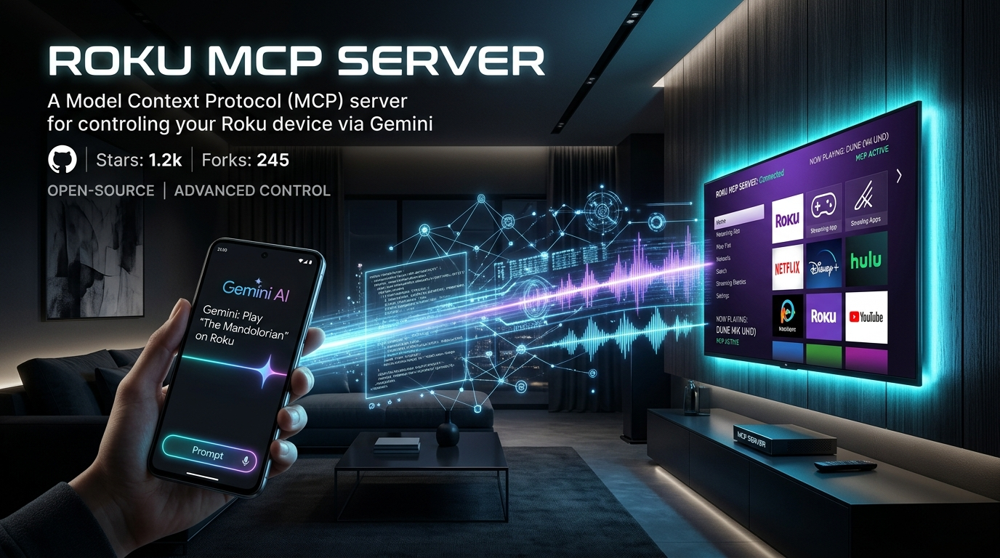
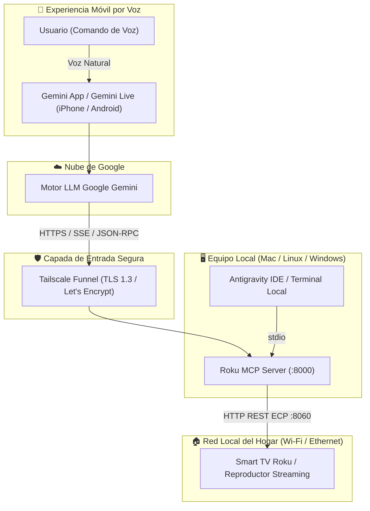
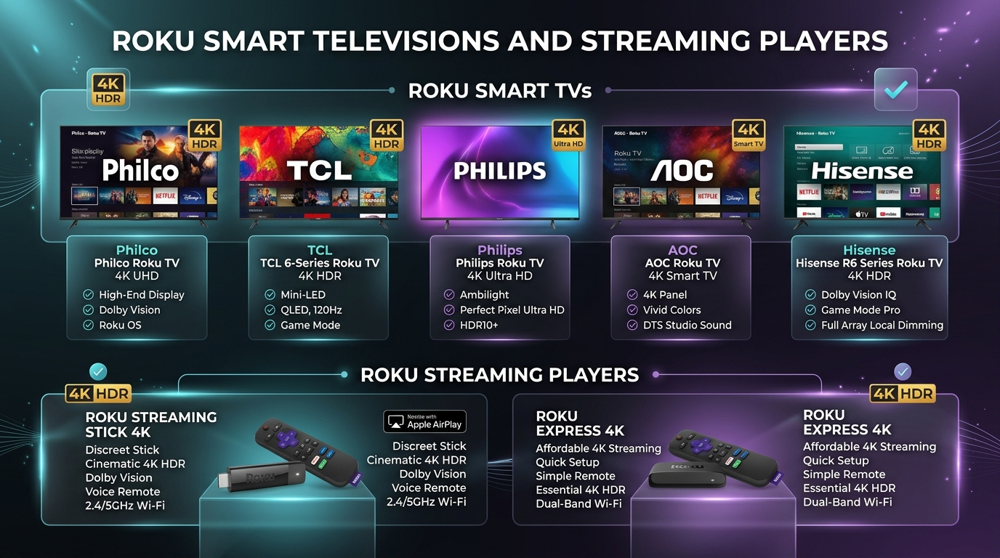
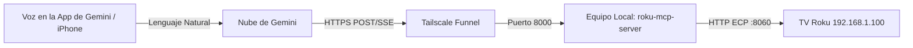

<div align="center">

# 📺 Servidor Roku MCP (`roku-mcp-server`)

**Servidor Model Context Protocol (MCP) de alto rendimiento para el control por voz y texto de Smart TVs y dispositivos Roku mediante Google Gemini (iPhone, Android y Escritorio) y Antigravity IDE.**

[](https://www.python.org/)
[](https://modelcontextprotocol.io/)
[](https://gemini.google.com/)
[](https://www.roku.com/)
[](docs/SECURITY_AUDIT.md)
[](LICENSE)

<br/>

🌐 **Idiomas:** [English](README.md) | [Português (Brasil)](README.pt-BR.md) | **Español**

<br/>



</div>

---

## 🌟 Características Destacadas

- 🗣️ **Control Total por Voz en Gemini para iPhone:** Habla con tu televisor de forma natural utilizando **Google Gemini Live** o instrucciones de voz.
- ⚡ **Transporte Dual Universal MCP:** Compatible con transmisión continua **SSE (Server-Sent Events)** y sincronización directa **Streamable HTTP JSON-RPC** con soporte CORS completo.
- 🔒 **Seguridad Zero-Trust:** Comunicación cifrada hacia Google Cloud mediante **Tailscale Funnel** con certificados oficiales TLS de Let's Encrypt. **Cero puertos abiertos en el router y sin riesgos de UPnP.**
- 🛡️ **Auditado con Google CodeMender:** Evaluación de seguridad contra vulnerabilidades OWASP y riesgos en agentes de IA (Calificación A+ 100/100).
- 📺 **Amplia Compatibilidad de Hardware:** Funciona en todas las Smart TVs con Roku OS (Philco, TCL, AOC, Philips, Semp, Hisense) y reproductores Roku Express/Stick.
- 🚀 **Máxima Velocidad:** Creado con `uv`, Python 3.10+ y `httpx` asíncrono para tiempos de respuesta menores a 50ms por comando.

---

## 🏛️ Arquitectura de la Solución



---

## 📺 Dispositivos y Modelos de Televisores Compatibles

Este servidor MCP es compatible con **cualquier televisor o reproductor que ejecute el sistema operativo Roku OS** (desde la versión 9.x hasta **Roku OS 16.x**).



### 1. Smart TVs con Roku OS Integrado
| Fabricante | Modelos Populares | Funciones Soportadas |
| :--- | :--- | :--- |
| **Philco** | PTV50G70, PTV58G70R2CSGBL4K, PTV32G70RCH, PTV55G7ER2CP | 4K UHD, HDR10, Apple AirPlay, ECP veloz |
| **TCL** | Series 3, 4, 5 y 6 (QLED 4K y Mini-LED) | 4K Dolby Vision, Modo Juego, Sonido Envolvente |
| **AOC** | 32S5195, 43S5195, 50U6295, 55U6295 | HD, Full HD, 4K UHD, DTS Studio Sound |
| **Philips** | 50PUG7625, 55PUG7625, 43PFG6825 | 4K UHD, Iluminación Ambilight, HDR10+ |
| **Hisense** | Series R6, R7, R8, U6GR | 4K HDR, Dolby Vision IQ, Full Array Dimming |
| **Semp** | R5500, R6500 | Smart TV HD y Full HD con Roku OS |
| **Otras Marcas** | JVC, Sharp, Hitachi, RCA, Insignia, Westinghouse | Todos los modelos con Roku OS oficial |

### 2. Reproductores Roku de Streaming (HDMI)
- **Roku Express / Express 4K / 4K+** (Modelos 3930X, 3940X, 3941X)
- **Roku Streaming Stick / Streaming Stick 4K / 4K+** (Modelos 3810X, 3820X)
- **Roku Ultra / Ultra LT** (Modelos 4800X, 4802X)
- **Roku Streambar / Streambar Pro** (Modelos 9102X)

---

## ⚙️ Requisito Fundamental: Modo Permisivo en la TV

Las versiones actuales de Roku OS vienen de fábrica con el modo de red en **"Limitado"**, lo que bloquea cambios de volumen, encendido y apertura remota de canales.

**Para permitir el control total mediante Gemini, activa el modo Permisivo en tu televisor (toma 10 segundos):**

1. En el control remoto físico de tu TV, ve a **Configuración** (`Settings`).
2. Accede a **Sistema** (`System`) > **Configuración avanzada del sistema** (`Advanced system settings`).
3. Selecciona **Control por aplicaciones móviles** (`Control by mobile apps`).
4. Cambia **Acceso a la red** (`Network access`) de *Limitado* a **Permisivo** (`Permissive`).

---

## 🚀 Instalación y Puesta en Marcha

### 1. Requisitos Previos
- Python 3.10 o superior
- [uv](https://github.com/astral-sh/uv) (recomendado para máxima velocidad) o `pip`
- [Tailscale](https://tailscale.com/) (para conectar remotamente con tu iPhone vía internet) o Cloudflare Tunnel

### 2. Instalación
```bash
# Clona el repositorio
git clone https://github.com/romuloigor/roku-mcp.git
cd roku-mcp

# Sincroniza las dependencias con uv
uv sync
```

### 3. Configuración del Archivo `.env`
Copia el archivo de plantilla e introduce la dirección IP de tu televisor:
```bash
cp .env.example .env
```
Edita `.env`:
```env
ROKU_HOST=192.168.1.100   # Dirección IP local de tu televisor Roku
ROKU_PORT=8060
MCP_HOST=0.0.0.0
MCP_PORT=8000
MCP_TRANSPORT=sse
```

### 4. Prueba de Conexión
Ejecuta la suite de pruebas contra el televisor:
```bash
just -f Justfile test
# o: uv run python tests/test_roku.py
```

---

## 📱 Conexión con la App de Gemini en iPhone (Voz)



### Paso 1: Ejecutar el Servidor en Segundo Plano
En macOS, instala el servicio persistente (`launchd`):
```bash
just -f Justfile install-service
```
*(En Linux o Windows, ejecuta `just -f Justfile serve` o usa el supervisor de tu preferencia).*

### Paso 2: Exponer la URL Segura con Tailscale Funnel
```bash
tailscale funnel 8000
```
Esto generará tu URL pública oficial con certificado SSL automático de Let's Encrypt:
`https://<nombre-de-tu-maquina>.<tu-tailnet>.ts.net/sse`

### Paso 3: Registrar en los Conectores de Gemini
1. En tu navegador web (Mac, PC o Safari en iPhone), abre:  
   **[gemini.google.com/customize/connectors](https://gemini.google.com/customize/connectors)**
2. Haz clic en el botón **+ Personalizado** (*+ Custom*).
3. En el campo **URL del servidor MCP**, introduce tu dirección:
   ```text
   https://<nombre-de-tu-maquina>.<tu-tailnet>.ts.net/sse
   ```
4. Haz clic en **Avanzar**.
5. Desplaza los términos de privacidad hasta el final, marca la casilla de confirmación y pulsa **Conectar**.

**¡Listo!** El conector se sincronizará automáticamente con la **App de Gemini en tu iPhone** bajo la misma cuenta de Google.

---

## 🗣️ Guía de Comandos de Voz de Ejemplo

Habla con total naturalidad a Google Gemini en tu iPhone o a través de **Gemini Live**:

| Acción | Comando de Voz en Español | Resultado |
| :--- | :--- | :--- |
| **Abrir Aplicaciones** | *"Gemini, abre YouTube en la tele de la sala"* | Inicia la app directamente por su ID de canal |
| **Ajustar Volumen** | *"Baja el volumen de la tele un 20%"* | Envía comandos secuenciales de reducción de volumen |
| **Silenciar** | *"Pon la tele en silencio"* | Activa el modo Mute de inmediato |
| **Encender / Apagar** | *"Apaga la televisión"* | Ejecuta la rutina segura de apagado |
| **Consultar Estado** | *"¿Qué aplicación está abierta en la tele?"* | Devuelve el canal activo y detalles del televisor |
| **Escritura de Texto** | *"Escribe 'Música relajante' en el buscador de la tele"* | Escribe carácter por carácter en el cuadro de búsqueda |
| **Navegación** | *"Vuelve a la pantalla de inicio"* | Envía la tecla Home del mando a distancia |

---

## 🛠️ Catálogo de Herramientas (*Tools*) MCP

| Nombre de Herramienta | Descripción | Parámetros |
| :--- | :--- | :--- |
| `roku_get_status` | Devuelve el estado de energía, canal activo y datos de red | Ninguno |
| `roku_power` | Enciende, apaga o conmuta la alimentación del televisor | `action`: `"on"`, `"off"`, `"toggle"` |
| `roku_launch_app` | Abre aplicaciones por nombre (YouTube, Netflix, Prime, Disney+, etc.) | `app_name`: string |
| `roku_adjust_volume` | Sube, baja o silencia el audio del televisor | `action`: `"up"`, `"down"`, `"mute"`; `steps`: `1` a `20` |
| `roku_remote_key` | Simula pulsaciones del control (`home`, `ok`, `back`, `play`, `pause`, etc.) | `key`: string |
| `roku_type_text` | Escribe texto remotamente (ideal para búsquedas) | `text`: string |
| `roku_search` | Ejecuta la búsqueda universal integrada de Roku | `query`: término de búsqueda |
| `roku_list_apps` | Lista los canales instalados y el catálogo local | Ninguno |

---

## 🛡️ Auditoría de Seguridad Google CodeMender

Este proyecto ha sido evaluado bajo la metodología de defensa autónoma **Google DeepMind CodeMender**.

- **Sin Apertura de Puertos en el Router:** Conexión cifrada a través de la red mesh WireGuard de Tailscale.
- **Protección contra SSRF:** El destino está restringido a configuraciones de subred privada mediante variables de entorno.
- **Defensa ante Inyección de Comandos:** Validación estricta con lista permitida (`KEY_MAP`) y codificación de parámetros URL.
- **Protección del Hardware:** Umbrales de seguridad para evitar bucles descontrolados de volumen o encendido.

👉 Consulta el informe completo de auditoría: [**docs/SECURITY_AUDIT.md**](docs/SECURITY_AUDIT.md).

---

## 💻 Integración en Escritorio (Antigravity IDE / Claude Desktop)

Para uso local en terminal o entornos de desarrollo, añade la configuración a `mcp_config.json`:

```json
{
  "mcpServers": {
    "roku-control": {
      "command": "uv",
      "args": [
        "--directory",
        "/ruta/a/roku-mcp",
        "run",
        "python",
        "src/roku_mcp/server.py",
        "--transport",
        "stdio"
      ]
    }
  }
}
```

---

## 🤝 Contribuciones

¡Las contribuciones, informes de fallos y solicitudes de funciones son bienvenidos! Siéntete libre de abrir un [Issue](https://github.com/romuloigor/roku-mcp/issues) o enviar un Pull Request.

---

## 📄 Licencia

Distribuido bajo la licencia **MIT**. Para más detalles, consulta el archivo [`LICENSE`](LICENSE).

---

<div align="center">
  <b>Desarrollado con ❤️ por <a href="https://github.com/romuloigor">Rômulo Igor</a> & Squad Antigravity</b>
</div>
