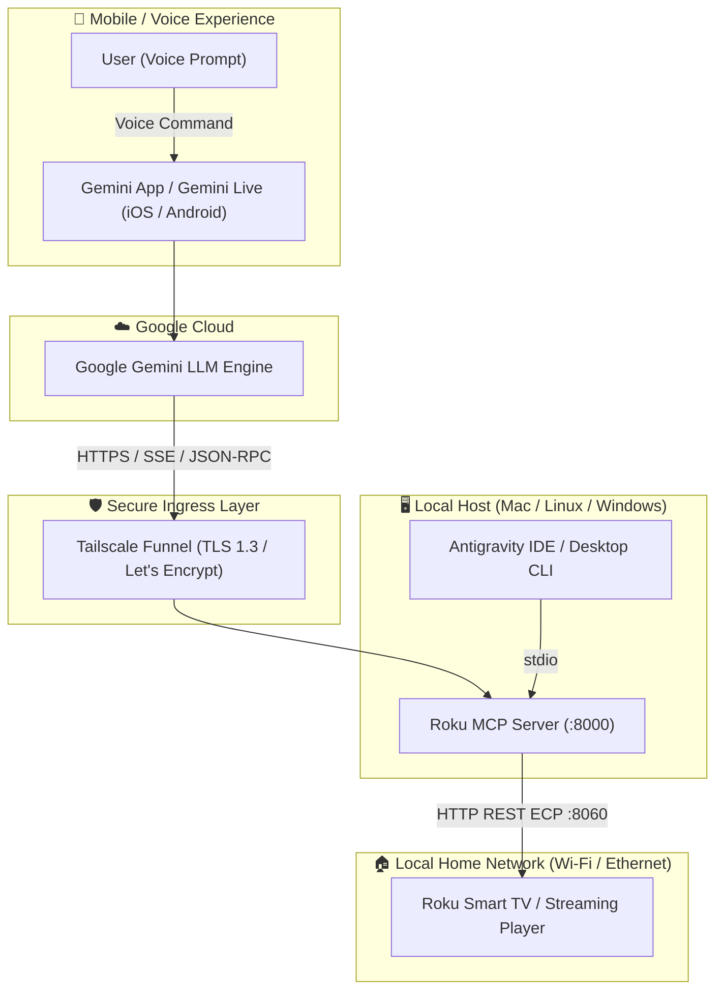
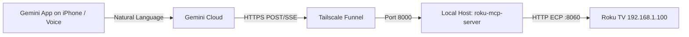

<div align="center">

# 📺 Roku MCP Server

**High-performance Model Context Protocol (MCP) server for hands-free, voice and text control of Roku Smart TVs and streaming devices via Google Gemini (iPhone, Android, and Desktop) and Antigravity IDE.**

[](https://www.python.org/)
[](https://modelcontextprotocol.io/)
[](https://gemini.google.com/)
[](https://www.roku.com/)
[](docs/SECURITY_AUDIT.md)
[](LICENSE)

<br/>

🌐 **Languages:** **English** | [Português (Brasil)](README.pt-BR.md) | [Español](README.es.md)

<br/>


</div>

---

## 🌟 Highlights

- 🗣️ **Seamless Voice Control via Gemini App on iPhone:** Talk to your television natively using **Google Gemini Live** or voice prompts.
- ⚡ **Universal Dual-Transport MCP:** Supports both modern **SSE (Server-Sent Events)** streaming and direct **Streamable HTTP JSON-RPC** handshaking with full CORS support.
- 🔒 **Zero-Trust Network Security:** Securely exposed to Google Cloud via **Tailscale Funnel** with official Let's Encrypt TLS certificates. **Zero open router ports or UPnP risks.**
- 🛡️ **Google CodeMender Audited:** Evaluated against OWASP and AI agent attack vectors (100% clean security bill of health).
- 📺 **Comprehensive Hardware Support:** Operates seamlessly across all Roku OS Smart TVs (Philco, TCL, AOC, Philips, Semp, Hisense) and Roku streaming sticks/players.
- 🚀 **Built for Speed:** Powered by `uv`, Python 3.10+, and async `httpx` for instantaneous (<50ms) command execution.

---

## 🏛️ Architecture



---

## 📺 Supported Devices & Televisions

This MCP server works with **any television or device powered by Roku OS** (versions 9.x through **Roku OS 16.x**).


### 1. Smart TVs with Roku OS
| Brand | Popular Supported Models | Capabilities |
| :--- | :--- | :--- |
| **Philco** | PTV50G70, PTV58G70R2CSGBL4K, PTV32G70RCH, PTV55G7ER2CP | 4K UHD, HDR10, AirPlay, Fast ECP |
| **TCL** | 3-Series, 4-Series, 5-Series, 6-Series (QLED & Mini-LED) | 4K Dolby Vision, High Refresh, Game Mode |
| **AOC** | 32S5195, 43S5195, 50U6295, 55U6295 | HD, Full HD, 4K UHD, DTS Studio Sound |
| **Philips** | 50PUG7625, 55PUG7625, 43PFG6825 | 4K UHD, Ambilight Integration, HDR10+ |
| **Hisense** | R6 Series, R7 Series, R8 Series, U6GR | 4K HDR, Dolby Vision IQ, Full Array Dimming |
| **Semp** | R5500, R6500 | HD, Full HD Roku TV |
| **Others** | JVC, Sharp, Hitachi, RCA, Insignia, Westinghouse Roku TVs | All models running official Roku OS |

### 2. Roku Streaming Players (HDMI)
- **Roku Express / Express 4K / 4K+** (Models 3930X, 3940X, 3941X)
- **Roku Streaming Stick / Streaming Stick 4K / 4K+** (Models 3810X, 3820X)
- **Roku Ultra / Ultra LT** (Models 4800X, 4802X)
- **Roku Streambar / Streambar Pro** (Models 9102X)

---

## ⚙️ Critical Prerequisite: TV Network Access Mode

Recent versions of Roku OS enforce a security restriction called **Limited Mode** by default, which blocks external volume, power, and channel switching.

**To enable full control by Gemini, unlock Permissive mode on your TV (takes 10 seconds):**

1. On your physical Roku remote, open **Settings** (`Configurações`).
2. Navigate to **System** (`Sistema`) > **Advanced system settings** (`Configurações avançadas do sistema`).
3. Select **Control by mobile apps** (`Controle por aplicativos móveis`).
4. Change **Network access** (`Acesso à rede`) from *Limited* to **Permissive** (`Permissivo`).

---

## 🚀 Quickstart

### 1. Requirements
- Python 3.10 or higher
- [uv](https://github.com/astral-sh/uv) (recommended) or standard `pip`
- [Tailscale](https://tailscale.com/) (for remote Gemini iPhone connectivity) or Cloudflare Tunnel

### 2. Installation
```bash
# Clone the repository
git clone https://github.com/romuloigor/roku-mcp.git
cd roku-mcp

# Install dependencies using uv
uv sync
```

### 3. Configuration
Copy `.env.example` to `.env` and adjust the TV IP address if needed:
```bash
cp .env.example .env
```
Edit `.env`:
```env
ROKU_HOST=192.168.1.100   # Replace with your TV's local IP address
ROKU_PORT=8060
MCP_HOST=0.0.0.0
MCP_PORT=8000
MCP_TRANSPORT=sse
```

### 4. Test Connectivity
```bash
just -f Justfile test
# or: uv run python tests/test_roku.py
```

---

## 📱 Connecting to Google Gemini on iPhone



### Step 1: Run the Server in Background (macOS / Linux / Windows)
On macOS, install the automated `launchd` background service:
```bash
just -f Justfile install-service
```
*(On Linux/systemd or Windows, simply run `just -f Justfile serve` or use your supervisor of choice).*

### Step 2: Expose Secure HTTPS via Tailscale Funnel
```bash
tailscale funnel 8000
```
This generates your official public URL with an automated Let's Encrypt SSL certificate:
`https://<your-machine-name>.<your-tailnet>.ts.net/sse`

### Step 3: Register in Gemini Connectors
1. In your browser (Mac, PC, or Safari on iPhone), go to **[gemini.google.com/customize/connectors](https://gemini.google.com/customize/connectors)**.
2. Click **+ Custom** (*+ Personalizado*).
3. In **MCP Server URL**, enter your public endpoint:
   ```text
   https://<your-machine-name>.<your-tailnet>.ts.net/sse
   ```
4. Click **Next** (*Avançar*).
5. Scroll down the security disclaimer, check the consent box, and click **Connect** (*Conectar*).

**Done!** The connector will now synchronize instantly with the **Gemini App on your iPhone**.

---

## 🗣️ Voice Commands Reference

You can talk naturally to Google Gemini on iPhone (or Gemini Live):

| Purpose | Voice Command (English) | Voice Command (Portuguese) | Voice Command (Spanish) |
| :--- | :--- | :--- | :--- |
| **Launch Apps** | *"Gemini, open YouTube on the living room TV"* | *"Gemini, abre o YouTube na TV da sala"* | *"Gemini, abre YouTube en la tele"* |
| **Volume Control** | *"Lower the TV volume by 10 points"* | *"Abaixa o volume da TV em 10 pontos"* | *"Baja el volumen de la tele 10 puntos"* |
| **Mute / Unmute** | *"Mute the television"* | *"Coloca a TV no mudo"* | *"Silencia la televisión"* |
| **Power Control** | *"Turn off the television"* | *"Desliga a TV"* | *"Apaga la tele"* |
| **Device Status** | *"What is playing on the TV right now?"* | *"O que está passando na TV agora?"* | *"¿Qué aplicación está abierta en la tele?"* |
| **Text Typing** | *"Search for classical rock music on TV"* | *"Digita rock clássico na busca da TV"* | *"Escribe rock clásico en el buscador de la tele"* |
| **Navigation** | *"Go back to the home screen"* | *"Volta para o início"* | *"Vuelve a la pantalla de inicio"* |

---

## 🛠️ MCP Tools Reference

| Tool Name | Description | Key Parameters |
| :--- | :--- | :--- |
| `roku_get_status` | Retrieves TV power state, active app/channel, network, and hardware info | None |
| `roku_power` | Controls TV power state | `action`: `"on"`, `"off"`, or `"toggle"` |
| `roku_launch_app` | Launches an app by name or ID (YouTube, Netflix, Prime, Disney+, etc.) | `app_name`: string |
| `roku_adjust_volume` | Modifies TV audio volume or toggles mute | `action`: `"up"`, `"down"`, `"mute"`; `steps`: `1`–`20` |
| `roku_remote_key` | Simulates physical remote keypresses (`home`, `ok`, `back`, `play`, etc.) | `key`: string |
| `roku_type_text` | Sequential character-by-character typing for text search inputs | `text`: string |
| `roku_search` | Triggers native Roku universal content search | `query`: string |
| `roku_list_apps` | Lists installed channels and cached catalog | None |

---

## 🛡️ Security & Google CodeMender Audit

This project has been independently evaluated and verified using **Google DeepMind's CodeMender** automated security methodology.

- **Zero Router Port Forwarding:** Relies exclusively on Tailscale WireGuard mesh encryption.
- **SSRF Protection:** Strict destination binding to private subnet environment configurations.
- **Injection Defense:** Allowlist key validation and RFC-compliant URL encoding.
- **Hardware Protection:** Enforced safety thresholds on rapid volume/power sequences.

👉 Read the full audit: [**docs/SECURITY_AUDIT.md**](docs/SECURITY_AUDIT.md).

---

## 💻 Desktop Integration (Antigravity IDE / Claude Desktop)

For local desktop usage, add the server to your MCP configuration file (`mcp_config.json`):

```json
{
  "mcpServers": {
    "roku-control": {
      "command": "uv",
      "args": [
        "--directory",
        "/path/to/roku-mcp",
        "run",
        "python",
        "src/roku_mcp/server.py",
        "--transport",
        "stdio"
      ]
    }
  }
}
```

---

## 🤝 Contributing

Contributions, issues, and feature requests are welcome! Feel free to check the [issues page](https://github.com/romuloigor/roku-mcp/issues).

---

## 📄 License

Distributed under the **MIT License**. See [`LICENSE`](LICENSE) for more details.

---

<div align="center">
  <b>Developed with ❤️ by <a href="https://github.com/romuloigor">Rômulo Igor</a> & Squad Antigravity</b>
</div>
