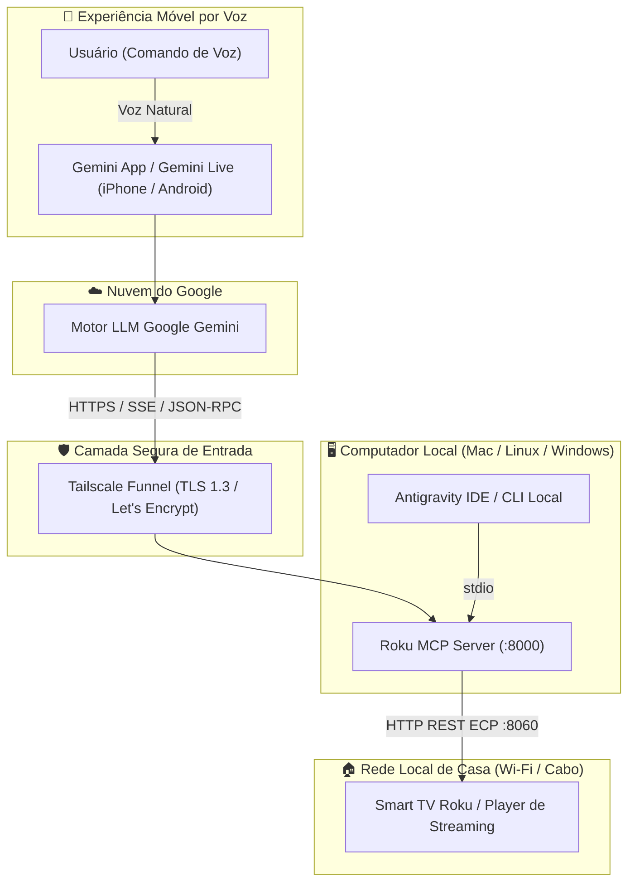
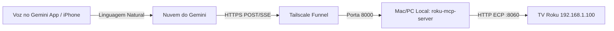

<div align="center">

# 📺 Servidor Roku MCP (`roku-mcp-server`)

**Servidor Model Context Protocol (MCP) de alta performance para controle por voz e texto de Smart TVs e dispositivos Roku através do Google Gemini (iPhone, Android e Desktop) e Antigravity IDE.**

[](https://www.python.org/)
[](https://modelcontextprotocol.io/)
[](https://gemini.google.com/)
[](https://www.roku.com/)
[](docs/SECURITY_AUDIT.md)
[](LICENSE)

<br/>

🌐 **Idiomas:** [English](README.md) | **Português (Brasil)** | [Español](README.es.md)

<br/>


</div>

---

## 🌟 Principais Recursos

- 🗣️ **Controle Total por Voz no Gemini do iPhone:** Converse naturalmente com sua TV usando o **Google Gemini Live** ou mensagens de voz.
- ⚡ **Transporte Duplo Universal MCP:** Suporte nativo tanto a streaming contínuo via **SSE (Server-Sent Events)** quanto a handshake direto via **Streamable HTTP JSON-RPC** com CORS total.
- 🔒 **Segurança Zero-Trust:** Comunicação segura com o Google Cloud via **Tailscale Funnel** com certificados TLS oficiais Let's Encrypt. **Zero portas abertas no roteador e sem UPnP vulnerável.**
- 🛡️ **Auditado com Google CodeMender:** Avaliado contra vulnerabilidades OWASP e riscos em agentes de IA (Classificação A+ 100/100).
- 📺 **Amplo Suporte a Televisores e Dispositivos:** Compatível com todas as Smart TVs com Roku OS (Philco, TCL, AOC, Philips, Semp, Hisense) e aparelhos Roku Express/Stick.
- 🚀 **Velocidade Extrema:** Desenvolvido com `uv`, Python 3.10+ e `httpx` assíncrono para latência inferior a 50ms por comando.

---

## 🏛️ Arquitetura da Solução



---

## 📺 Dispositivos e Modelos de TV Suportados

Este servidor MCP é compatível com **qualquer televisão ou dispositivo de streaming que execute o sistema operacional Roku OS** (desde a versão 9.x até o mais recente **Roku OS 16.x**).


### 1. Smart TVs com Roku OS Integrado
| Fabricante | Modelos Mais Populares | Recursos Suportados |
| :--- | :--- | :--- |
| **Philco** | PTV50G70, PTV58G70R2CSGBL4K, PTV32G70RCH, PTV55G7ER2CP | 4K UHD, HDR10, Apple AirPlay, ECP rápido |
| **TCL** | Séries 3, 4, 5 e 6 (QLED 4K e Mini-LED) | 4K Dolby Vision, Modo Jogo, Áudio Atmos |
| **AOC** | 32S5195, 43S5195, 50U6295, 55U6295 | HD, Full HD, 4K UHD, Som DTS Studio |
| **Philips** | 50PUG7625, 55PUG7625, 43PFG6825 | 4K UHD, Iluminação Ambilight, HDR10+ |
| **Hisense** | Séries R6, R7, R8, U6GR | 4K HDR, Dolby Vision IQ, Full Array Dimming |
| **Semp** | R5500, R6500 | Smart TV HD e Full HD Roku OS |
| **Outras Marcas** | JVC, Sharp, Hitachi, RCA, Insignia, Westinghouse | Todos os modelos com Roku OS oficial |

### 2. Dispositivos Roku de Streaming (HDMI)
- **Roku Express / Express 4K / 4K+** (Modelos 3930X, 3940X, 3941X)
- **Roku Streaming Stick / Streaming Stick 4K / 4K+** (Modelos 3810X, 3820X)
- **Roku Ultra / Ultra LT** (Modelos 4800X, 4802X)
- **Roku Streambar / Streambar Pro** (Modelos 9102X)

---

## ⚙️ Pré-requisito Crítico: Modo Permissivo na TV

As versões modernas do Roku OS vêm de fábrica no modo **"Limitado"**, bloqueando alterações de volume, energia e abertura de canais por terceiros.

**Para liberar o controle pelo Gemini, ative o modo Permissivo na TV (leva 10 segundos):**

1. No controle remoto físico da TV, vá em **Configurações** (`Settings`).
2. Acesse **Sistema** (`System`) > **Configurações avançadas do sistema** (`Advanced system settings`).
3. Selecione **Controle por aplicativos móveis** (`Control by mobile apps`).
4. Altere **Acesso à rede** (`Network access`) de *Limitado* para **Permissivo** (`Permissive`).

---

## 🚀 Instalação e Execução

### 1. Pré-requisitos
- Python 3.10 ou superior
- [uv](https://github.com/astral-sh/uv) (recomendado para máxima performance) ou `pip`
- [Tailscale](https://tailscale.com/) (para comunicação com o iPhone via internet) ou Cloudflare Tunnel

### 2. Instalação
```bash
# Clone o repositório
git clone https://github.com/romuloigor/roku-mcp.git
cd roku-mcp

# Sincronize as dependências com o uv
uv sync
```

### 3. Configuração do Arquivo `.env`
Copie o arquivo de exemplo e insira o IP da sua TV:
```bash
cp .env.example .env
```
Edite o arquivo `.env`:
```env
ROKU_HOST=192.168.1.100   # Substitua pelo IP da sua TV na rede Wi-Fi local
ROKU_PORT=8060
MCP_HOST=0.0.0.0
MCP_PORT=8000
MCP_TRANSPORT=sse
```

### 4. Teste de Comunicação
Execute a suíte de testes contra a TV:
```bash
just -f Justfile test
# ou: uv run python tests/test_roku.py
```

---

## 📱 Conectando ao Gemini App no iPhone (Voz)



### Passo 1: Executar o Servidor em Segundo Plano
No macOS, instale o serviço automático (`launchd`):
```bash
just -f Justfile install-service
```
*(No Linux ou Windows, execute `just -f Justfile serve` ou use seu gerenciador de processos preferido).*

### Passo 2: Expor via Tailscale Funnel com HTTPS
```bash
tailscale funnel 8000
```
Isso gerará a URL pública oficial com certificado SSL Let's Encrypt:
`https://<nome-da-sua-maquina>.<seu-tailnet>.ts.net/sse`

### Passo 3: Cadastrar nos Conectores do Gemini
1. No navegador do computador ou no Safari do iPhone, abra:  
   **[gemini.google.com/customize/connectors](https://gemini.google.com/customize/connectors)**
2. Clique no botão **+ Personalizado**.
3. No campo **URL do servidor MCP**, insira sua URL:
   ```text
   https://<nome-da-sua-maquina>.<seu-tailnet>.ts.net/sse
   ```
4. Clique em **Avançar**.
5. Role os termos de privacidade até o final, marque a caixa de confirmação e clique em **Conectar**.

**Pronto!** O conector sincroniza imediatamente com o **Gemini App no seu iPhone** logado na mesma conta Google.

---

## 🗣️ Guia de Comandos de Voz por Exemplo

Fale naturalmente com o Gemini no iPhone ou através do **Gemini Live**:

| Ação Desejada | Exemplo de Comando em Português | O que acontece |
| :--- | :--- | :--- |
| **Abrir Aplicativos** | *"Gemini, abre o YouTube na TV da sala"* | O app é aberto diretamente pelo ID do canal |
| **Ajustar Volume** | *"Abaixa o volume da TV em 20%"* | Envia comandos sucessivos de VolumeDown |
| **Silenciar Som** | *"Coloca a TV no mudo"* | Dispara o comando VolumeMute instantaneamente |
| **Ligar / Desligar** | *"Desliga a televisão"* | Aciona a rotina segura de desligamento |
| **Consultar Status** | *"O que está passando na TV agora?"* | Retorna o app em execução e modelo do televisor |
| **Digitação de Texto** | *"Digita 'Alok ao vivo' na busca da TV"* | Digita caractere por caractere no campo de pesquisa |
| **Navegação** | *"Volta para a tela inicial"* | Envia a tecla Home do controle remoto |

---

## 🛠️ Catálogo de Ferramentas (*Tools*) MCP

| Nome da Ferramenta | O que faz | Parâmetros |
| :--- | :--- | :--- |
| `roku_get_status` | Retorna se a TV está ligada/desligada, app aberto e modelo | Nenhum |
| `roku_power` | Liga, desliga ou alterna o estado da TV | `action`: `"on"`, `"off"`, `"toggle"` |
| `roku_launch_app` | Abre apps diretamente (YouTube, Netflix, Prime, Disney+, Globoplay, etc.) | `app_name`: string |
| `roku_adjust_volume` | Aumenta, abaixa ou silencia o áudio | `action`: `"up"`, `"down"`, `"mute"`; `steps`: `1` a `20` |
| `roku_remote_key` | Pressiona teclas do controle (`home`, `ok`, `back`, `play`, `pause`, etc.) | `key`: string |
| `roku_type_text` | Digitação sequencial remota (ideal para buscas) | `text`: string |
| `roku_search` | Dispara a pesquisa universal integrada da Roku | `query`: termo de busca |
| `roku_list_apps` | Lista os canais instalados e catálogo local de canais | Nenhum |

---

## 🛡️ Auditoria de Segurança Google CodeMender

Este projeto foi auditado seguindo a metodologia de defesa automatizada **Google DeepMind CodeMender**.

- **Sem Redirecionamento de Portas no Roteador:** Conexão 100% blindada via mesh WireGuard do Tailscale.
- **Proteção contra SSRF:** O destino é estritamente fixado por variáveis de ambiente de rede privada local.
- **Defesa contra Injeção de Comandos:** Mapeamento em lista restrita (`KEY_MAP`) e codificação RFC de parâmetros.
- **Salvaguarda de Hardware:** Limites estritos no loop de ajuste de volume para proteger alto-falantes.

👉 Veja o relatório completo de auditoria: [**docs/SECURITY_AUDIT.md**](docs/SECURITY_AUDIT.md).

---

## 💻 Integração com IDEs (Antigravity IDE / Claude Desktop)

Para uso local via terminal ou IDE, adicione no arquivo `mcp_config.json`:

```json
{
  "mcpServers": {
    "roku-control": {
      "command": "uv",
      "args": [
        "--directory",
        "/caminho/para/roku-mcp",
        "run",
        "python",
        "src/roku_mcp/server.py",
        "--transport",
        "stdio"
      ]
    }
  }
}
```

---

## 🤝 Como Contribuir

Contribuições, correções de bugs e novas sugestões de canais são muito bem-vindas! Fique à vontade para abrir uma [Issue](https://github.com/romuloigor/roku-mcp/issues) ou enviar um Pull Request.

---

## 📄 Licença

Distribuído sob a licença **MIT**. Consulte o arquivo [`LICENSE`](LICENSE) para mais detalhes.

---

<div align="center">
  <b>Desenvolvido com ❤️ por <a href="https://github.com/romuloigor">Rômulo Igor</a> & Squad Antigravity</b>
</div>
